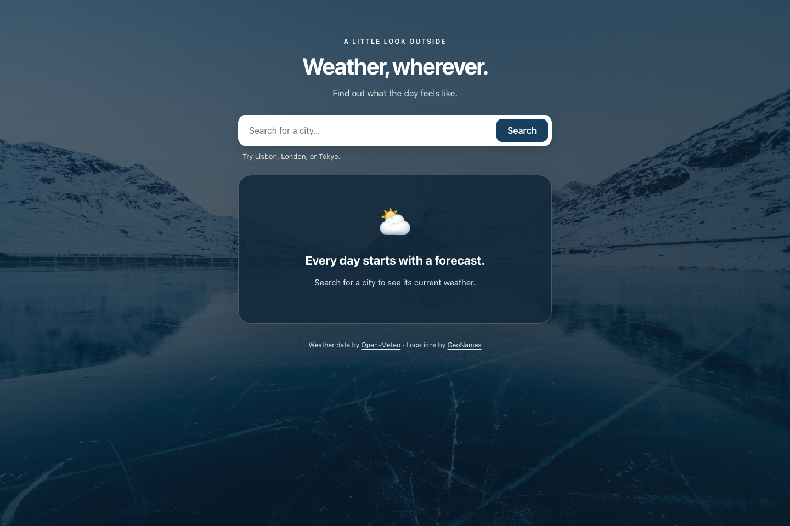
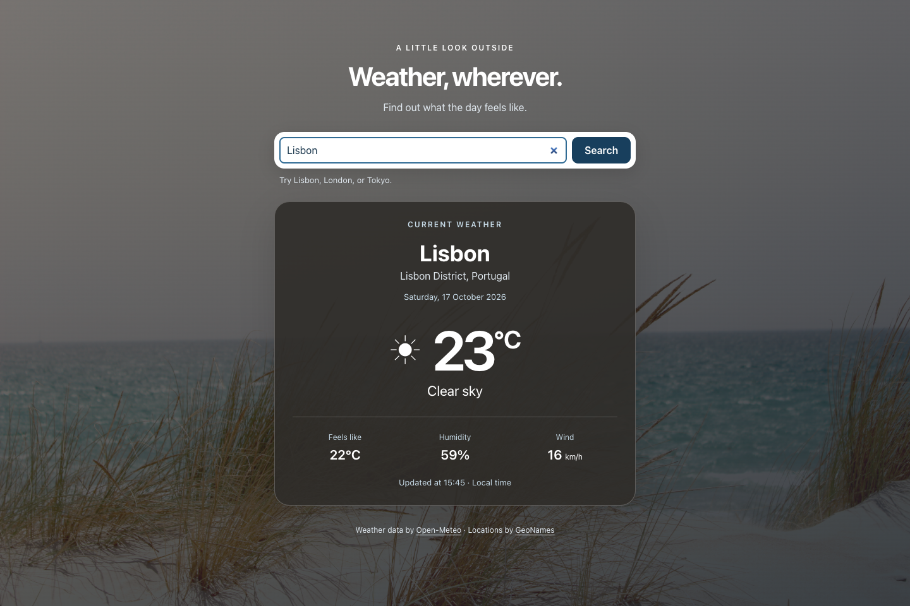

# Weather, wherever

A web app for checking a city's current weather, with a responsive interface and backgrounds that change with the temperature. Built with React and Vite, it uses Open-Meteo to retrieve weather data without an API key.

## Screenshots

### Initial screen

Search field, suggested cities, and a welcome message before the first search.



### Search result

Current conditions in Lisbon, including temperature, feels-like temperature, humidity, wind speed, and the observation's local time. The values shown are examples captured at a particular moment and vary between searches.



## Features

- **City search:** submit using the Search button or Enter key, with leading and trailing whitespace removed.
- **Current conditions:** temperature and feels-like temperature in °C, relative humidity as a percentage, and wind speed in km/h.
- **Location details:** city, region, and country returned by the geocoding service.
- **Weather descriptions:** weather codes mapped to descriptions and icons, including rain, snow, fog, and thunderstorms.
- **Local date and time:** observation date and time displayed in the searched city's timezone.
- **Dynamic backgrounds:** a warm-weather photo for temperatures above 16 °C and a cold-weather photo otherwise, including the initial screen.
- **Search feedback:** loading indicator and a temporarily disabled search button.
- **Error messages:** handling for short queries, missing cities, connection failures, invalid responses, and service outages.
- **Request timeout:** searches are canceled after 15 seconds, allowing the user to retry.
- **Previous result preserved:** failed searches display an error while keeping the last successful weather result.
- **Responsive, accessible interface:** small-screen layouts, keyboard search, visible focus indicators, and messages identified for assistive technologies.

## Technologies

| Technology | Purpose |
| --- | --- |
| React 17 and React DOM | Functional components and UI updates |
| JavaScript with ES Modules | Code organization and reuse |
| Vite 6 and the React plugin | Development server and production builds |
| CSS | Flexbox and Grid layouts, photo backgrounds, and media queries |
| Fetch API | Asynchronous HTTP requests to external services |
| AbortController | Cancellation of active requests |
| Intl.DateTimeFormat | Date and time formatting by timezone |
| ESLint and React Hooks rules | Static code analysis |
| node:test and node:assert/strict | Automated tests without an additional framework |

## Technical implementation

### Separation of concerns

`App.jsx` manages the form and search lifecycle. The `WeatherCard` component receives normalized data and displays weather conditions. The `weather.js` service handles API requests and response validation, while utility functions handle date formatting and weather-code descriptions.

This structure allows service integration and data formatting to be tested without rendering the UI.

### API integration

Each valid search follows this flow:

1. Validate the city name, requiring at least two characters after `trim()`.
2. Query the geocoding API and select the first result.
3. Use the returned latitude and longitude to request current weather conditions.
4. Validate numeric fields and normalize the response into the format used by the UI.
5. Display the data and update the background based on the temperature.

| Service | Endpoint | Purpose |
| --- | --- | --- |
| Open-Meteo Geocoding | `https://geocoding-api.open-meteo.com/v1/search` | Resolve a city name to coordinates |
| Open-Meteo Forecast | `https://api.open-meteo.com/v1/forecast` | Retrieve temperature, feels-like temperature, humidity, weather code, and wind speed |

Requests use HTTPS. `URL` and `URLSearchParams` construct addresses and encode parameters, including names with accents or special characters. Units are explicitly set to Celsius and km/h.

The service requests Unix timestamps and the local timezone using `timezone=auto`. It converts timestamps from seconds to milliseconds before formatting them with `Intl.DateTimeFormat`.

### State, cancellation, and cleanup

- `useState` manages the search text, result, loading state, and error message.
- `useRef` stores the active request controller and timeout reference.
- A new search cancels the previous request and clears its timeout.
- Results from canceled requests are ignored so they cannot overwrite a more recent search.
- The timeout cancels the request after 15 seconds and displays a timeout message.
- The `useEffect` cleanup function cancels the request and clears the timeout when the component unmounts.

### Validation and error handling

The service distinguishes network failures, unsuccessful HTTP responses, invalid JSON, missing locations, and incomplete weather data. Numeric fields are checked with `Number.isFinite` to avoid displaying invalid values. Canceled requests preserve the `AbortError` type.

### Accessibility and presentation

The form includes a label associated with the search field and supports keyboard submission. Error messages use `role="alert"`; the results area uses `aria-live` and `aria-busy` to communicate updates and loading state. Decorative icons are hidden from assistive technologies.

The CSS uses a maximum content width, Flexbox for the form, Grid for weather details, and a media query for screens up to 480 px wide. Background images are local assets included in the build.

### Development tools

Vite replaces the original Create React App setup. The project retains React 17 and includes a lockfile for reproducible installation with `npm ci`. Tests use the built-in Node.js test runner without additional testing dependencies.

## Project structure

```text
weatherApp/
├── docs/
│   └── screenshots/          # Screenshots used in this README
├── public/                   # Favicon, manifest, and static files
├── src/
│   ├── assets/               # Warm and cold background photos
│   ├── components/
│   │   └── WeatherCard.jsx   # Current weather presentation
│   ├── services/
│   │   ├── weather.js        # Geocoding and weather requests
│   │   └── weather.test.js   # Service tests
│   ├── test/
│   │   └── fixtures.js       # Sample responses for tests
│   ├── utils/
│   │   ├── weather.js        # Weather codes, dates, and times
│   │   └── weather.test.js   # Formatting and condition tests
│   ├── App.jsx               # Form and search management
│   ├── index.css             # Global and responsive styles
│   └── index.jsx             # React app entry point
├── eslint.config.js
├── index.html
├── package-lock.json
├── package.json
└── vite.config.js
```

## Run locally

### Requirements

- Node.js 18.18 or newer; a maintained LTS release is recommended.
- npm.
- An internet connection to access the APIs.

From the project directory, install dependencies and start the server:

```sh
npm ci
npm start
```

Open [http://localhost:3000](http://localhost:3000). Port 3000 must be available. Code changes are reflected automatically during development. To stop the server, press `Ctrl+C` in the terminal.

No `.env` file or API key is required.

### Available commands

| Command | Description |
| --- | --- |
| `npm start` | Start the development server on port 3000 |
| `npm run dev` | Run the same command as `npm start` |
| `npm run lint` | Check JavaScript and React Hooks rules |
| `npm test` | Run all automated tests |
| `npm run test:watch` | Rerun tests when files change |
| `npm run build` | Generate the production build in `dist/` |
| `npm run preview` | Serve the production build locally |

To check the production build:

```sh
npm run build
npm run preview
```

Open the address printed by Vite in the terminal.

## Tests

The 10 automated tests use simulated API responses and do not depend on an internet connection or current weather conditions.

| Area | Coverage |
| --- | --- |
| Weather service | Query encoding, metric units, data normalization, and cancellation signal forwarding |
| Validation | Queries that are too short and cities with no results |
| External errors | HTTP failures, network failures, invalid JSON, and incomplete weather data |
| Cancellation | Preservation of `AbortError` |
| Presentation | Dates and times in different timezones, including day boundaries |
| Conditions | Weather-code descriptions and a fallback for unknown codes |

```sh
npm test
npm run lint
npm run build
```

## Scope and data sources

The app displays current conditions and uses the first city search result. The interface and weather descriptions are in English. Data is refreshed when a search is submitted; there is no periodic automatic refresh, multi-day forecast, backend, or offline cache.

- [Open-Meteo Geocoding API](https://open-meteo.com/en/docs/geocoding-api): location search.
- [Open-Meteo Forecast API](https://open-meteo.com/en/docs): weather conditions.
- [GeoNames](https://www.geonames.org/): source of location data.
- [Open-Meteo terms](https://open-meteo.com/en/terms): terms of service.
